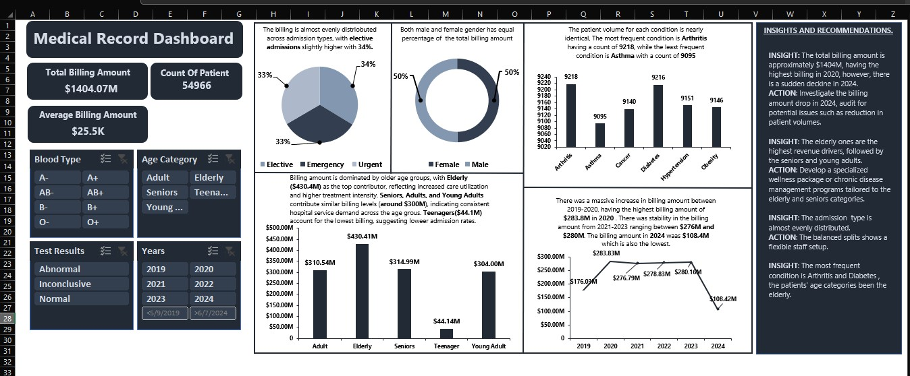

# Medical Record Dashboard (Excel)

An interactive Excel dashboard that analyses **$1.4B in hospital billing across 54,966 patient records**, showing where billing comes from by age category, medical condition, admission type, gender and year.



## Table of contents

- [Project overview](#project-overview)
- [Business questions](#business-questions)
- [Headline numbers](#headline-numbers)
- [Dataset](#dataset)
- [Tools used](#tools-used)
- [Repository structure](#repository-structure)
- [Data preparation](#data-preparation)
- [Dashboard features](#dashboard-features)
- [Key insights](#key-insights)
- [Recommendations](#recommendations)
- [Limitations and next steps](#limitations-and-next-steps)
- [How to use the dashboard](#how-to-use-the-dashboard)
- [Author](#author)

## Project overview

Hospitals need to know which patient groups drive revenue and how billing changes over time. This project turns a medical records dataset into a one-page dashboard built with pivot tables, pivot charts and slicers, so that non-technical users can explore billing patterns and filter every chart at once.


## Business questions

1. How much has the hospital billed in total, and what is the average bill per patient?
2. Which age groups, conditions and admission types contribute the most billing?
3. How has billing changed over time?
4. What actions can the hospital take based on these patterns?

## Headline numbers

| KPI | Value |
| --- | --- |
| Total billing amount | $1,404.07M |
| Count of patients | 54,966 |
| Average billing amount | $25.5K |

## Dataset

- **Source:** [Medical Record]
- **Size:** 54,966 patient records
- **Period covered:** about May 2019 to June 2024

| Field | Description |
| --- | --- |
| Patient identifiers | Patient name |
| Age and Age Category | Teenager, Young Adult, Adult, Senior, Elderly |
| Gender | Female / Male |
| Blood Type | A+, A-, B+, B-, AB+, AB-, O+, O- |
| Medical Condition | Arthritis, Asthma, Cancer, Diabetes, Hypertension, Obesity |
| Admission Type | Elective, Emergency, Urgent |
| Test Results | Normal, Abnormal, Inconclusive |
| Billing Amount | Amount billed per patient |
| Date of Admission | Used to build the Year field |

> The near-even splits in the data (for example 50/50 gender and roughly equal condition counts) suggest this is a sample or synthetic dataset. Findings should be read as a demonstration, not as real hospital performance.

## Tools used

- **Microsoft Excel:** data cleaning, pivot tables, pivot charts, slicers and dashboard layout
- **Excel formulas:** helper columns such as Age Category and Year

## Repository structure

```
medical-record-dashboard/
├── README.md
├── data/
│   └── medical_records.xlsx
├── dashboard/
│   └── Medical_Record_Dashboard.xlsx
├── screenshots/
│   └── dashboard.png
└── docs/
    └── Project_Summary.pdf
```

## Data preparation

| Step | Action |
| --- | --- |
| Check for blanks and duplicates | Removed duplicate records and handled missing values |
| Fix data types | Set dates, numbers and text correctly |
| Standardise text | Corrected inconsistent capitalisation in names and categories |
| Create Age Category | Grouped ages into Teenager, Young Adult, Adult, Senior and Elderly |
| Create Year | Extracted the year from the admission date |
| Build pivot tables | One per chart, all linked to the same slicers |

## Dashboard features

- **KPI cards:** Total Billing Amount, Count of Patient, Average Billing Amount
- **Charts:**
  - Billing by admission type (pie)
  - Billing by gender (donut)
  - Patient count by medical condition (column)
  - Billing by age category (column)
  - Billing trend by year (line)
- **Slicers:** Blood Type, Age Category, Test Results, Years (timeline)
- **Insights and recommendations panel** written beside the charts

## Key insights

| Area | Finding |
| --- | --- |
| Admission type | Almost evenly split: Elective 34%, Emergency 33%, Urgent 33% |
| Gender | Billing split 50/50 between female and male patients |
| Medical condition | Nearly equal volumes: Arthritis highest (9,218), Asthma lowest (9,095) |
| Age category | Elderly bring in the most ($430.41M); Seniors ($314.99M), Adults ($310.54M) and Young Adults ($304.00M) are similar; Teenagers lowest ($44.14M) |
| Billing over time | 2019: $176.03M, 2020: $283.83M (peak), 2021: $276.79M, 2022: $278.83M, 2023: $280.16M, 2024: $108.42M |

**In short**

1. Age is the main driver of revenue: the Elderly are the top contributors.
2. Billing is stable at about $277M to $280M a year from 2020 to 2023.
3. Admission types and conditions are balanced, so no single type dominates.
4. The 2024 figure is much lower, but the data appears to cover only part of 2024 (and part of 2019), so the drop should not be read as a real decline until full years are compared.

## Recommendations

1. **Elderly and Senior patients:** develop wellness and chronic-disease management programmes for these groups, which bring in the most billing.
2. **Arthritis and Diabetes:** these are the most frequent conditions, so plan specialist capacity and follow-up care around them.
3. **Staffing:** keep staffing flexible, since admission types are evenly balanced.
4. **2024 billing:** verify whether the drop reflects incomplete data or a real change in patient volume before taking action.


## How to use the dashboard

1. Download or clone this repository.
2. Open `dashboard/Medical_Record_Dashboard.xlsx` in Microsoft Excel (desktop version recommended for slicers).
3. Click any slicer button (Blood Type, Age Category, Test Results, Years) to filter all charts.
4. Click the clear-filter icon at the top right of a slicer to reset it.

## Author

**Michael Emmanuel**

- LinkedIn: [www.linkedin.com/in/michael-emmanuel-94758b292]
- Email: [michaelemmanuel685@gmail.com]
